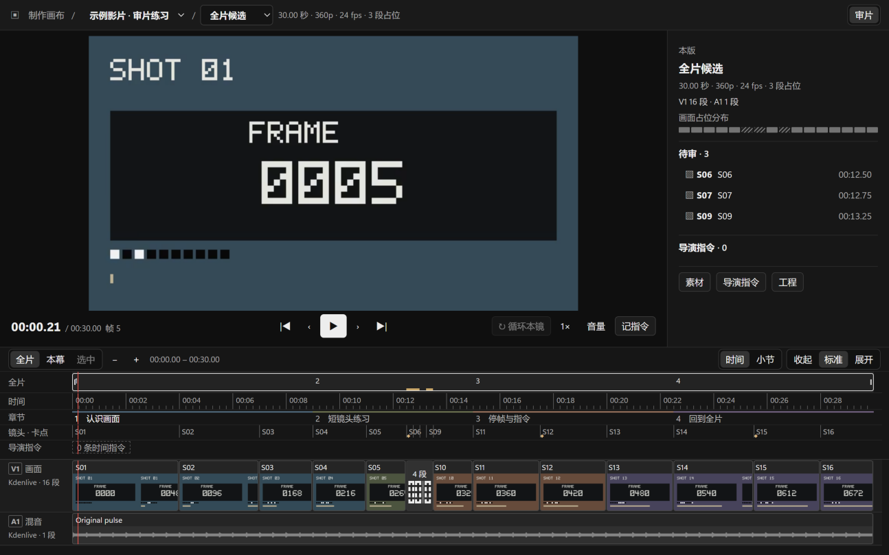

# Production Canvas / 制作画布

A local Windows review desk for a filmmaker working with AI assistants.
Pause on a frame, write a direction, and return to that frame when reviewing
the next candidate.

[中文说明](README.zh-CN.md) · [Download v1.5.0](https://github.com/justinzyc271828-sys/production-canvas-public/releases/tag/v1.5.0)

## Start in three steps

1. Download the Windows x64 portable EXE from the release page and run it.
2. Try the bundled 30-second sample. It contains 720 numbered frames, 16
   picture clips, four chapters, cue points and three placeholder clips.
3. Press Space to pause, N to write a direction, and Enter to save it.
   Resume playback and click the saved marker to return.

The interface is Chinese. The sample needs no account, Python installation
or production service. The current EXE is unsigned, so Windows may show an
unknown-publisher warning. Compare its SHA-256 with SHA256SUMS.txt on the
release page. [Windows signing notes](docs/windows-signing.md)

## Review your own film

Put a rendered MP4 and its matching Kdenlive edit in a directory. Add
project.json, then choose **项目 → 打开项目清单…**.

    {
      "schema": "production-canvas/v1",
      "title": "My film",
      "video": { "path": "media/review.mp4", "label": "Full review" },
      "timeline": "edit/film.kdenlive"
    }

The [project format](docs/project-format.md) documents optional chapters,
shots, placeholders, sound cues, music bars and focus exports.
The [complete sample](demo/project.json) is an editable starting point.

## What it does

- **Frame-linked directions.** Labels use the displayed video frame.
  Directions retain their version, frame, source position and shot ID when
  available. Their position is recalculated after an edit. Missing targets
  remain visible for review.
- **Review timeline.** Actual Kdenlive tracks and editorial markers have
  separate rows. Short clips and dense directions can be expanded from
  groups. Timeline zoom and height are independent.
- **Production handoff.** Copy a direction for an AI assistant, then inspect
  a returned candidate with a SHA-256 receipt. A configured local ComfyUI
  workflow opens read-only inside the same window.

The API listens on loopback and requires a fresh desktop-session token.
Project media and directions stay in the selected local directory.

## Local MCP control

The local working build includes an authenticated MCP bridge for project
selection, playback, frame and shot navigation, screenshots and frame-linked
directions. The Python adapter and connection instructions are in
[mcp/README.md](mcp/README.md). Its tools require the current project, timeline
revision and video hash for changes. This addition is available in the local
MCP-enabled build and source checkout.

The [MCP implementation handoff](docs/mcp-handoff-2026-11-04.md) records the
verified scope, source snapshot and remaining distribution boundary.

## Keyboard

| Key | Action |
| --- | --- |
| Space | Play or pause |
| Left / Right | Previous or next frame |
| Alt + Left / Right | Previous or next cut |
| N | Write a quick direction |
| Enter / Esc | Save or discard the quick direction |
| [ / ] | Previous or next direction |
| Shift + Z | Zoom to the selected clip |
| Ctrl + 0 | Show the full film |
| Ctrl + 1 / Ctrl + 2 | Review view / configured ComfyUI view |

Text fields, selects and open dialogs retain their normal keyboard behavior.

## Build and verify

Use Node.js 24 on Windows x64.

    npm ci
    npm run check
    npm run verify:sample
    npm run pack:win

The tests cover project formats, direction relocation, candidate hashes and
the actual Electron review flow. The desktop check reads the visual frame
marker through all 720 sample frames and checks 30 playback pauses.
Packaging requires a clean commit and embeds its full SHA.
[Verification instructions](docs/verification.md)

## Current scope

The native Kdenlive reader supports ordinary tracks, blanks and cuts.
Nested sequences and timewarp clips need a flattened review edit.
Playback uses the rendered review video. The optional Kdenlive adapter can
render working copies of supported CLI-Anything JSON edits.
ComfyUI and other production tools are separate local installations.

## License

The Production Canvas Source License 1.0 permits personal use and commercial
creative work, including paid video projects. Free modified distributions
are allowed under its conditions. Selling the software and providing paid
hosted access require separate written permission.

The same license covers this repository's original demo media and artwork.
Third-party components retain their own terms.
[License](LICENSE) · [中文许可](LICENSE.zh-CN.md) · [Third-party notices](THIRD_PARTY_NOTICES.md)

This project is distributed as source-available software.
Report reproducible issues through this repository's Issues page.
