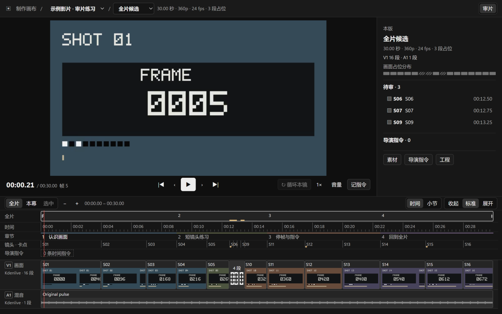

# 制作画布

给独立视频创作者使用的本地审片工具。暂停后写下一条意见，
之后可以从时间线回到对应画面，并把意见交给 AI 助手处理。

[下载 Windows 便携版](https://github.com/justinzyc271828-sys/production-canvas-public/releases/tag/v1.5.0)
· [English](README.md)

## 三步试用

1. 下载发行页中的 Windows x64 EXE 并运行。
2. 打开后会进入 30 秒内置示例，包含 16 个画面片段、4 个章节、卡点和
   3 个占位镜头。画面中央有每一帧的编号。
3. 按空格暂停，按 N 输入意见，再按 Enter 保存。继续播放后，
   点时间线上的指令标记，就能回到原帧。

界面为中文。示例不需要账号、Python 或制作服务。当前 EXE 未签名，
Windows 可能提示未知发布者。发行页提供 SHA256SUMS.txt 供核对文件。

## 接入自己的影片

准备一个目录，放入审片 MP4、对应的 Kdenlive 工程，以及 project.json。
在软件中选择“项目 → 打开项目清单…”。

    {
      "schema": "production-canvas/v1",
      "title": "我的影片",
      "video": { "path": "media/review.mp4", "label": "全片候选" },
      "timeline": "edit/film.kdenlive"
    }

文件路径相对于项目目录，引用文件须位于这个目录内。
章节、镜头、占位和声音卡点可以放在独立的 review.json 中。
[项目格式说明](docs/project-format.md) · [完整示例](demo/project.json)

## 常用操作

| 操作 | 方法 |
| --- | --- |
| 播放、暂停 | 空格 |
| 逐帧前后移动 | 左右方向键 |
| 跳到相邻剪辑点 | Alt + 左右方向键 |
| 记一句指令 | N → 输入 → Enter |
| 放弃快记 | Esc |
| 跳到相邻指令 | [ / ] |
| 定位短镜头 | 点片段或待审列表，再用“循环本镜” |
| 调整时间线 | “全片／本幕／选中”及“收起／标准／展开” |
| 查看制作工程 | 配置本机 ComfyUI 后，点“ComfyUI 画布” |

指令会保存版本、帧号，以及可取得的镜头号和素材内位置。改动剪辑后，
软件会重新计算位置。无法定位的指令会保留在“无法定位”分组。
候选结果和已批准素材分开保存，候选按 SHA-256 核对。

## 使用范围

- Windows x64，中文界面。
- 原生 Kdenlive 支持普通轨道、空白和剪辑点读取。嵌套序列、变速片段
  需要先整理为平铺审片工程。
- ComfyUI、Kdenlive 渲染和其他制作工具按需在本机另行配置。
- 本地接口只监听回环地址，每次启动使用新的会话令牌。

## 许可

允许个人使用，也允许用它接商单、做广告和制作商业视频。
可以按许可条件免费分发修改版。转售软件、出租软件或向他人提供收费
托管访问，需要另行书面许可。

原创示例素材和界面图像适用同一许可，第三方组件适用各自条款。
这是源码可见项目。
[英文许可](LICENSE) · [中文译文](LICENSE.zh-CN.md)

开发者可运行 npm run check 和 npm run verify:sample。
后者会在隔离示例中核对全部 720 帧和 30 次播放暂停。
[开发与验收说明](docs/verification.md)

遇到问题时，请在 Issues 中附上版本号、Windows 版本和使用内置示例
复现的步骤。
